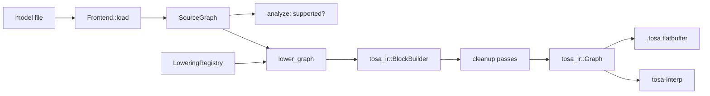

## Overview

`tosa-convert` turns models in other formats into TOSA graphs. It is a
framework plus frontends: the framework owns everything that is the same for
every format, and a frontend owns everything that is specific to one.



Design choices, and why:

- **No universal operator set.** A `SourceGraph` keeps each format's own
  operator names and attributes (`CONV_2D` with TFLite's padding enum,
  `Conv` with ONNX's `pads`). Lowerings translate exactly one format's
  semantics, so there is no lossy middle dialect to get wrong.
- **Lowerings are plain functions** registered by operator name in a
  `LoweringRegistry`. A frontend is complete when every operator of the
  models you care about has an entry; `analyze` lists what is missing before
  any work happens.
- **The IR does the bookkeeping.** `tosa_ir::BlockBuilder` hands out
  `TensorRef`s carrying names, types and shapes, generates unique names,
  records operator locations and serializes the result. The interpreter
  validates the output and is the oracle for testing it.
- **Shared arithmetic lives in the framework.** `quant` computes RESCALE
  multipliers and shifts in the convention of the TensorFlow TOSA
  legalization, so quantized models reproduce TFLite's reference kernels;
  `layout` handles channels-first to channels-last conversion; `passes`
  cleans up what straightforward lowerings leave behind.

## The pieces

| Item | Where | Role |
|---|---|---|
| `SourceGraph`, `SourceTensor`, `SourceNode` | `source.rs` | A model as parsed: tensors with a `SourceDType` (including types TOSA lacks, such as `U8`), shape, optional quantization and optional constant data; nodes with the format's operator name, operands and attributes. |
| `Frontend`, `FrontendSet` | `frontend.rs` | Parsing one format into a `SourceGraph`, plus the registry of its lowerings. The set selects a frontend by name, by sniffing the file or by extension. |
| `LoweringRegistry`, `LowerCtx`, `lower_graph` | `lower.rs` | The driver. `LowerCtx::value` resolves a source tensor to a TOSA tensor, materializing constants as CONST operators on first use; `emit` declares an output with the source tensor's type and shape. |
| `analyze`, `Report` | `lower.rs` | Supported and unsupported operator counts for a model. |
| `quant` | `quant.rs` | `scale32` / `scale16` fixed-point approximations and `emit_rescale`. |
| `layout` | `layout.rs` | Permutations, their composition and inverse, and `transpose`. |
| `passes` | `passes.rs` | `cancel_transposes`, `fold_constants` (evaluates constant sub-graphs with the interpreter), `eliminate_dead_code`. |

## Adding a frontend

1. **Parse the format** into a `SourceGraph`. Give every tensor a stable
   name; keep constant data as `TensorData`; translate quantization
   parameters into `Quantization`. Put the frontend behind a Cargo feature
   and register it in `default_frontends`.
2. **Register lowerings** for each operator. A lowering reads its operands
   with `ctx.value`, reads conversion-time constants (shapes, axes) with
   `ctx.constant_ints`, emits TOSA operators with `ctx.emit` /
   `ctx.emit_temp` and the helpers in `quant` and `layout`, and binds every
   node output. Use `ctx.fail` for unsupported attribute combinations so the
   error names the node.
3. **Test against the native runtime.** Generate small models, run them in
   the format's own runtime on seeded inputs, convert, run with
   `tosa-interp` and compare: bit-exact for integer paths, ULP tolerances for
   float. Run the emitted graph through the reference model too, which is the
   authority on ERROR_IF and level checks.

The toy frontend in `crates/tosa-convert/tests/framework.rs` shows the
whole flow in a few dozen lines.

## Command line

```sh
tosa convert model.tflite -o model.tosa     # lower; the frontend is detected from the file
tosa convert model.tflite --analyze         # list supported and unsupported operators only
tosa frontends                              # which frontends this binary has
tosa run model.tosa -i input=x.npy --stats  # execute, with statistics
tosa run --case crates/tosa-interp/tests/networks/mobilenet_like
tosa dump model.tosa                        # readable listing
tosa check model.tosa                       # validate and show the execution plan
```

## Status

The framework, the IR builder and serializer, the cleanup passes and the
command line are in place and tested. No file-format frontend is built in
yet; TFLite is the first planned, then ONNX, then ExecuTorch `.pte`.
