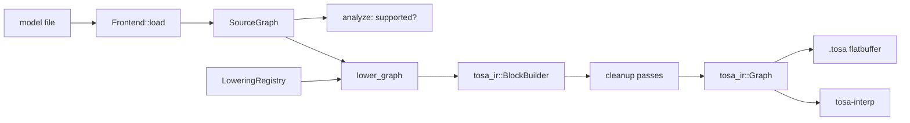

## Overview

`tosa-convert` turns models in other formats into TOSA graphs. It is a
framework plus frontends: the framework owns everything that is the same for
every format, and a frontend owns everything that is specific to one.



Design choices, and why:

- **No universal operator set.** A `SourceGraph` keeps each format's own
  operator names and attributes (`CONV_2D` with TFLite's padding enum,
  `Conv` with ONNX's `pads`). Lowerings translate exactly one format's
  semantics, so there is no lossy middle dialect to get wrong.
- **Lowerings are plain functions** registered by operator name in a
  `LoweringRegistry`. A frontend is complete when every operator of the
  models you care about has an entry; `analyze` lists what is missing before
  any work happens.
- **The IR does the bookkeeping.** `tosa_ir::BlockBuilder` hands out
  `TensorRef`s carrying names, types and shapes, generates unique names,
  records operator locations and serializes the result. The interpreter
  validates the output and is the oracle for testing it.
- **Shared arithmetic lives in the framework.** `quant` computes RESCALE
  multipliers and shifts in the convention of the TensorFlow TOSA
  legalization, so quantized models reproduce TFLite's reference kernels;
  `layout` handles channels-first to channels-last conversion; `passes`
  cleans up what straightforward lowerings leave behind.

## The pieces

| Item | Where | Role |
|---|---|---|
| `SourceGraph`, `SourceTensor`, `SourceNode` | `source.rs` | A model as parsed: tensors with a `SourceDType` (including types TOSA lacks, such as `U8`), shape, optional quantization and optional constant data; nodes with the format's operator name, operands and attributes. |
| `Frontend`, `FrontendSet` | `frontend.rs` | Parsing one format into a `SourceGraph`, plus the registry of its lowerings. The set selects a frontend by name, by sniffing the file or by extension. |
| `LoweringRegistry`, `LowerCtx`, `lower_graph` | `lower.rs` | The driver. `LowerCtx::value` resolves a source tensor to a TOSA tensor, materializing constants as CONST operators on first use; `emit` declares an output with the source tensor's type and shape. |
| `analyze`, `Report` | `lower.rs` | Supported and unsupported operator counts for a model. |
| `quant` | `quant.rs` | `scale32` / `scale16` fixed-point approximations and `emit_rescale`. |
| `layout` | `layout.rs` | Permutations, their composition and inverse, and `transpose`. |
| `passes` | `passes.rs` | `cancel_transposes`, `fold_constants` (evaluates constant sub-graphs with the interpreter), `eliminate_dead_code`. |

## Adding a frontend

1. **Parse the format** into a `SourceGraph`. Give every tensor a stable
   name; keep constant data as `TensorData`; translate quantization
   parameters into `Quantization`. Put the frontend behind a Cargo feature
   and register it in `default_frontends`.
2. **Register lowerings** for each operator. A lowering reads its operands
   with `ctx.value`, reads conversion-time constants (shapes, axes) with
   `ctx.constant_ints`, emits TOSA operators with `ctx.emit` /
   `ctx.emit_temp` and the helpers in `quant` and `layout`, and binds every
   node output. Use `ctx.fail` for unsupported attribute combinations so the
   error names the node.
3. **Test against the native runtime.** Generate small models, run them in
   the format's own runtime on seeded inputs, convert, run with
   `tosa-interp` and compare: bit-exact for integer paths, ULP tolerances for
   float. Run the emitted graph through the reference model too, which is the
   authority on ERROR_IF and level checks.

The toy frontend in `crates/tosa-convert/tests/framework.rs` shows the
whole flow in a few dozen lines.

## Command line

```sh
tosa convert model.tflite -o model.tosa     # lower; the frontend is detected from the file
tosa convert model.tflite --analyze         # list supported and unsupported operators only
tosa frontends                              # which frontends this binary has
tosa run model.tosa -i input=x.npy --stats  # execute, with statistics
tosa run --case crates/tosa-interp/tests/networks/mobilenet_like
tosa run model.tosa --case target/models/mobilenet_v1_1.0_224 --dump-dir /tmp/dump
tosa dump model.tosa                        # readable listing
tosa check model.tosa                       # validate and show the execution plan
```

## The TFLite frontend

`tosa-convert`'s `tflite` feature (on by default) reads `.tflite` models
through flatbuffer bindings generated from TensorFlow's `schema.fbs`
(v2.19.0, vendored in `crates/tosa-convert/schema/`). Single-subgraph models
are supported.

**Operators** (float and quantized unless noted): CONV_2D, DEPTHWISE_CONV_2D,
FULLY_CONNECTED, AVERAGE_POOL_2D, MAX_POOL_2D, ADD, SUB, MUL, RESHAPE,
SQUEEZE, EXPAND_DIMS, SOFTMAX, LOGISTIC, TANH, RELU, RELU6, RELU_N1_TO_1,
QUANTIZE, DEQUANTIZE, PAD, MEAN, CONCATENATION, and the fused activations of
the above. `tosa convert --analyze` lists what a given model needs.

**Quantized arithmetic** follows TFLite's reference kernels and is bit-exact
against them for the models tested:

- Convolutions accumulate in INT32 with the input and weight zero points
  (TOSA takes them as operands), add the INT32 bias, and requantize with a
  per-channel RESCALE in double-rounding mode, which is identical to
  TFLite's `MultiplyByQuantizedMultiplier` (checked on 20,000 random values
  including negatives).
- ADD and SUB rescale both operands to INT32 with TFLite's 20-bit left shift
  and `scale / (2 * max(scale_a, scale_b))` multipliers, add, and requantize.
  MUL multiplies in INT32 and requantizes by `scale_a * scale_b / scale_out`.
- AVERAGE_POOL_2D, MAX_POOL_2D, PAD and CONCATENATION stay in the quantized
  domain (inputs of a CONCATENATION with other parameters are requantized).
- TFLite floors output sizes where TOSA requires the window to tile the
  input exactly, so inputs are SLICEd to the size the windows cover.

**uint8 models.** TOSA has no unsigned types. uint8 tensors are re-expressed
as INT8 with values and zero points shifted by 128, which preserves every
real value, so weights and the arithmetic are unchanged. The converted
graph's inputs and outputs keep the model's names and are INT8 tensors
holding the uint8 *bits*: a RESCALE with `input_unsigned` converts each input
on entry and one with `output_unsigned` converts each output on exit. Feed a
uint8 array's bytes as the INT8 input and read the INT8 output as uint8.

**Multiplier derivation.** Requantization multipliers are derived exactly as
TFLite derives them, including its mixed precision: the legacy uint8 kernels
multiply the input and weight scales in float32 before converting to double,
the int8 per-channel kernels multiply in double, and MUL computes its
multiplier in float32 throughout. The difference between a float32 and a
double product is a few parts in 10^8, which moves the rounding boundary
enough to change about one element in 20,000 and, compounded through a deep
network, most of the final outputs.

**Known approximations.** SOFTMAX, LOGISTIC and TANH on quantized tensors
are computed in FP32 between a dequantize and a quantize rather than with
TFLite's lookup-table and fixed-point kernels. On the models tested this
agrees with TFLite on the recorded inputs and differs by at most one unit
on at most 0.2% of the outputs over other seeds (EfficientNet-Lite0 int8 in
the runtime matrix); everything upstream of these operators is bit-exact.
QUANTIZE rounds half to even where TFLite rounds half away from zero.
CONCATENATION of inputs with differing parameters uses RESCALE where TFLite
requantizes in float.

## The ONNX frontend

`tosa-convert`'s `onnx` feature (on by default) reads `ModelProto` files
through a hand-written protobuf reader (`onnx/proto.rs`, about 400 lines),
so no protobuf toolchain is involved in building. Single-graph float models
of the default operator domain are supported; symbolic input dimensions
(a `batch_size` of unknown value) become 1.

**Operators**: Conv (grouped only as depthwise), MaxPool, AveragePool
(`count_include_pad` 0), GlobalAveragePool, GlobalMaxPool, Gemm, MatMul,
BatchNormalization (folded into a per-channel multiply and add), Relu, Clip,
LeakyRelu, Sigmoid, Tanh, Exp, Log, Abs, Neg, Floor, Ceil, Erf, Sqrt,
Reciprocal, Add, Sub, Mul, Div, Pow, Max, Min, Softmax (both the pre- and
post-opset-13 semantics), Flatten, Reshape, Squeeze, Unsqueeze, Transpose,
Concat, Identity, Dropout, Pad, ReduceMean, Cast, and Shape, Gather and
Slice on static shapes, which are evaluated at conversion time so the
`Reshape(x, Concat(Gather(Shape(x), 0), [-1]))` idiom exporters emit becomes
a plain RESHAPE.

**Layout.** ONNX is channels-first. Convolutions and pools transpose their
input to NHWC and their result back; the cleanup passes cancel the
transposes that meet between layers and sink the ones blocked by
element-wise operators (`sink_transposes` moves a TRANSPOSE from the inputs
of Relu, Add, BatchNormalization's multiply and so on to their outputs,
transposing constant operands instead, which constant folding then
absorbs). A typical CNN keeps one transpose after the input and one before
its first flatten; MobileNetV2 converts to 268 TOSA operators, the same as
its TFLite counterpart.

**Numerics.** Float ONNX models are checked against onnxruntime's CPU
provider, whose convolution and GEMM kernels accumulate in a blocked order,
so results agree to float32 rounding rather than bit for bit: elements must
satisfy `|a - e| <= 1e-5 + 1e-4 |e|` (observed maxima: 1e-5 absolute on
MobileNetV2 logits). Quantized ONNX (QLinearConv, QuantizeLinear) is not
supported yet.

## Verification

Three oracles, in increasing strictness of what they check:

1. **Checked-in cases** (`crates/tosa-convert/tests/tflite/` and
   `tests/onnx/`): small models built by `scripts/tflite_testcases.py`
   (flatc JSON compiled with `flatc`) and `scripts/onnx_testcases.py`
   (`onnx.helper`), with the native runtime's outputs recorded. They run in
   `cargo test`, offline.
2. **Well-known models** (`scripts/models.py`): TFLite MobileNet v1 and v2
   (float and uint8) and EfficientNet-Lite0 (float and int8), and ONNX
   MobileNetV2, SqueezeNet 1.1 and ResNet-18 from the ONNX model zoo,
   downloaded with pinned hashes into `target/models/`, with LiteRT's or
   onnxruntime's outputs on seeded inputs.
   `cargo test --release -p tosa-convert --test models` converts and runs
   them, requiring bit-exact quantized results (all four quantized models
   are) and float results within 1e-6 (observed: 2e-9);
   `cargo bench -p tosa-convert` benchmarks conversion and execution. Both skip when the models are absent. CI runs them on
   every push with the downloads cached.
3. **The TOSA reference model**: `scripts/models.py --verify` converts each
   model with the `tosa` CLI and runs the result through
   `tosa_reference_model`, so the emitted graphs are checked by the
   specification's own implementation. The weekly reference workflow does
   this on Linux and macOS.

### Cross-runtime matrix

`scripts/runtime_matrix.py` is the reproducible stress test across runtimes:
for every well-known model and several seeds it runs the same inputs
through the native runtime (LiteRT with reference kernels and with its
default optimized kernels, or onnxruntime), through `tosa-interp` on the
converted graph, and through the TOSA reference model when tosa-tools is
available, then reports the worst-case error of each against the native
reference run and the minimum and median time of each (plus conversion
time). Models are pinned by hash, inputs come from the seeds, and the
package versions are recorded in `target/runtime-matrix/results.json`
next to the Markdown report.

```sh
uv run --with tosa-tools==2026.8.0 scripts/runtime_matrix.py             # everything
uv run scripts/runtime_matrix.py --only onnx_resnet18-v1-7 --seeds 5 --runs 20
```

`tosa run --repeat N --json` is what the script uses to time the
interpreter; it is available for ad-hoc measurements too.

What a run of the matrix shows (one machine, 3 seeds, 10 runs; the numbers
move with hardware, the relationships do not):

- `tosa-interp` and the TOSA reference model agree bit for bit on every
  model and seed, quantized and float, which is the property the interpreter
  exists for.
- Against TFLite's reference kernels, the quantized MobileNets are exact and
  EfficientNet-Lite0 int8 is within one unit on 0.2% of outputs (its int8
  SOFTMAX, see above); the float models agree to about 1e-8.
- LiteRT's *optimized* kernels differ from LiteRT's own reference kernels by
  up to 8 units on the quantized models, with as few as 36% of MobileNet v2's
  logits identical: the deployed kernels are a noisier oracle than the
  specification they implement.
- Float ONNX models agree with onnxruntime to float32 rounding (1e-5
  absolute on logits; large relative differences appear only on outputs
  near zero).
- Speed: `tosa-interp` is 1.5 to 2 times faster than LiteRT's reference
  kernels on float models and on par with them on quantized ones, 3 to 15
  times faster than the TOSA reference model, and 10 to 30 times slower than
  the optimized LiteRT and onnxruntime kernels, which use multithreaded SIMD
  GEMMs.

The oracle is LiteRT with its *reference* kernels
(`OpResolverType.BUILTIN_REF`). Its optimized kernels and the XNNPACK
delegate differ from the reference arithmetic by one unit in rare elements
(about 1 in 20,000 for a 1x1 convolution), which compounds through a
network; the reference kernels define the semantics the lowering follows.

To look into a difference layer by layer, `tosa run --dump-dir DIR` writes
every operator's outputs with an `ops.json` index that records each
operator's source location (the TFLite tensor it came from).

## Status

The framework, the TFLite and ONNX frontends, the model tests and the
command line are in place. Next: quantized ONNX (QLinear operators),
ExecuTorch `.pte`, and a broader operator set as models need it.
