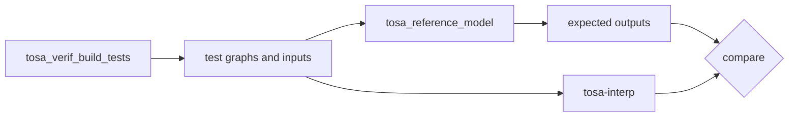

## Overview

This document tracks, operator by operator, what tosa-interp implements,
how it is tested and how much of the TOSA specification the tests cover.

The baseline is the TOSA 1.1 draft specification as implemented by the
tosa-tools reference model, version **v2026.08.0** (the `tosa-tools` Python
wheel). Every claim of correctness below is a bit-exact comparison with
that reference model unless stated otherwise. [TESTING.md](TESTING.md)
describes the test suites, the harness and CI in more detail.

## How operators are verified



Test graphs come from the tosa-tools test generator; the reference model
produces the expected outputs; the `conformance` test target runs every
graph through tosa-interp and compares the results.

1. `scripts/gen_conformance.py` runs the tosa-tools test generator for an
   operator. It produces positive tests (every supported type combination,
   attribute edge cases and special-value data such as NaN, infinities and
   extreme magnitudes) and ERROR_IF negative tests (graphs the specification
   says must be rejected).
2. The reference model runs each test in its native-precision mode and its
   outputs are stored as the expected results. Tests it reports as
   unpredictable are dropped.
3. `cargo test --test conformance` runs every case through tosa-interp.
   Positive outputs must match **bit for bit** (any NaN equals any NaN).
   Negative cases must be rejected with an error.
4. The only tolerance is for ERF, LOG, POW, SIN, COS, FFT2D and RFFT2D. The
   reference evaluates them with the host C library (`erf`, `logf`, `sinf`,
   `cosf`), whose results differ by an ULP or two between Windows, Linux and
   macOS, so no single implementation can match every platform bit for bit.
   tosa-interp uses the portable `libm` crate, giving identical results on
   every platform, and the harness accepts 2 ULPs (5 for ERF, the
   specification's bound) or, for the FFTs, an absolute error of 2^-20 times
   the sum of the input magnitudes. Set `TOSA_CONFORMANCE_STRICT=1` to
   require bit-exact results everywhere.

The generator emits thousands of cases per operator, so the checked-in suite
(`tests/conformance`) is a sample: up to three positive cases per type
signature (and per special-value variant; one for MATMUL and MATMUL_T, two
for RESIZE, whose cases are large), and up to three ERROR_IF cases per error
kind, drawn from different type signatures. The complete suites can be built
and run locally:

```sh
uv run scripts/gen_conformance.py --full --op conv2d
TOSA_CONFORMANCE_DIR=target/conformance-full cargo test --release --test conformance
```

(In PowerShell, set the variable with
`$env:TOSA_CONFORMANCE_DIR = "target/conformance-full"` first.)

The MX (microscaling) extensions are excluded from generation, as
tosa-interp does not implement them.

## Coverage estimate

For each operator the report compares what the tests exercise with what the
tosa-tools generator defines for the operator across *all* profiles and
extensions, including MX:

- **Type signatures**: distinct input/accumulator/output type combinations.
- **ERROR_IF kinds**: distinct kinds of invalid graph.

The estimate weights type signatures three to one against ERROR_IF kinds. It
measures breadth (which combinations are exercised and match the reference),
not the number of test values. The specification's type lists include the MX
formats, which tosa-interp does not implement, so operators with MX variants
(CAST, CONCAT, CONV2D, MATMUL_T, RESHAPE, RESIZE, ROW_GATHER) show below 100%.
The "Non-MX type signatures" column shows coverage of everything else.

## Summary

The table is regenerated by `scripts/conformance_report.py` (run it after
regenerating suites). "Full suite" is the complete generator output, run
locally from `target/conformance-full`; `-` means it was not generated.

<!-- BEGIN GENERATED -->
- Checked-in suite: 3057/3057 cases pass (1668 positive, 1389 ERROR_IF) across 90 operators.
- Full suites: 77262/77262 cases pass.
- Type signatures: 591/1224 of all, 589/589 excluding MX; ERROR_IF kinds: 468/468.

| Operator | Positive (pass/total) | ERROR_IF (pass/total) | Full suite (pass/total) | Type signatures (tested/spec) | Non-MX type signatures | ERROR_IF kinds (tested/spec) | Coverage estimate |
|---|---|---|---|---|---|---|---|
| ABS | 15/15 | 6/6 | 50/50 | 5/5 | 5/5 | 2/2 | 100% |
| ADD | 15/15 | 15/15 | 95/95 | 5/5 | 5/5 | 5/5 | 100% |
| ADD_SHAPE | 3/3 | 18/18 | 22/22 | 1/1 | 1/1 | 6/6 | 100% |
| ARGMAX | 48/48 | 21/21 | 355/355 | 16/16 | 16/16 | 7/7 | 100% |
| ARITHMETIC_RIGHT_SHIFT | 12/12 | 15/15 | 152/152 | 4/4 | 4/4 | 5/5 | 100% |
| ASSERT_EQUAL_SHAPE | 3/3 | 12/12 | 29/29 | 1/1 | 1/1 | 4/4 | 100% |
| AVG_POOL2D | 24/24 | 33/33 | 6419/6419 | 8/8 | 8/8 | 11/11 | 100% |
| AVG_POOL2D_ADAPTIVE | 24/24 | 33/33 | 6378/6378 | 8/8 | 8/8 | 11/11 | 100% |
| BITWISE_AND | 12/12 | 15/15 | 76/76 | 4/4 | 4/4 | 5/5 | 100% |
| BITWISE_NOT | 12/12 | 6/6 | 40/40 | 4/4 | 4/4 | 2/2 | 100% |
| BITWISE_OR | 12/12 | 15/15 | 76/76 | 4/4 | 4/4 | 5/5 | 100% |
| BITWISE_XOR | 12/12 | 15/15 | 76/76 | 4/4 | 4/4 | 5/5 | 100% |
| CAST | 156/156 | 6/6 | 520/520 | 52/112 | 52/52 | 2/2 | 60% |
| CEIL | 9/9 | 6/6 | 30/30 | 3/3 | 3/3 | 2/2 | 100% |
| CLAMP | 15/15 | 9/9 | 60/60 | 5/5 | 5/5 | 3/3 | 100% |
| CLZ | 6/6 | 6/6 | 20/20 | 2/2 | 2/2 | 2/2 | 100% |
| CONCAT | 30/30 | 21/21 | 348/348 | 10/16 | 10/10 | 7/7 | 72% |
| CONCAT_SHAPE | 3/3 | 15/15 | 108/108 | 1/1 | 1/1 | 5/5 | 100% |
| COND_IF | 21/21 | 18/18 | 488/488 | 7/7 | 7/7 | 6/6 | 100% |
| CONST | 36/36 | 0/0 | 48/48 | 12/12 | 12/12 | 0/0 | 100% |
| CONST_SHAPE | 3/3 | 0/0 | 4/4 | 1/1 | 1/1 | 0/0 | 100% |
| CONV2D | 192/192 | 33/33 | 15446/15446 | 64/448 | 64/64 | 11/11 | 36% |
| CONV3D | 27/27 | 33/33 | 2721/2721 | 9/9 | 9/9 | 11/11 | 100% |
| COS | 9/9 | 6/6 | 30/30 | 3/3 | 3/3 | 2/2 | 100% |
| DEPTHWISE_CONV2D | 27/27 | 33/33 | 7296/7296 | 9/9 | 9/9 | 11/11 | 100% |
| DIM | 30/30 | 15/15 | 300/300 | 10/10 | 10/10 | 5/5 | 100% |
| DIV_CEIL_SHAPE | 3/3 | 18/18 | 22/22 | 1/1 | 1/1 | 6/6 | 100% |
| DIV_FLOOR_SHAPE | 3/3 | 18/18 | 22/22 | 1/1 | 1/1 | 6/6 | 100% |
| EQUAL | 15/15 | 15/15 | 95/95 | 5/5 | 5/5 | 5/5 | 100% |
| ERF | 9/9 | 6/6 | 30/30 | 3/3 | 3/3 | 2/2 | 100% |
| EXP | 9/9 | 6/6 | 30/30 | 3/3 | 3/3 | 2/2 | 100% |
| EXP2_SHAPE | 1/1 | 15/15 | 16/16 | 1/1 | 1/1 | 5/5 | 100% |
| FFT2D | 32/32 | 14/14 | 46/46 | 1/n/a | n/a | 7/7 | 100% |
| FLOOR | 9/9 | 6/6 | 30/30 | 3/3 | 3/3 | 2/2 | 100% |
| GATHER | 19/19 | 9/9 | 49/49 | 10/10 | 10/10 | 3/3 | 100% |
| GREATER | 15/15 | 15/15 | 95/95 | 5/5 | 5/5 | 5/5 | 100% |
| GREATER_EQUAL | 15/15 | 15/15 | 95/95 | 5/5 | 5/5 | 5/5 | 100% |
| IDENTITY | 36/36 | 0/0 | 48/48 | 12/12 | 12/12 | 0/0 | 100% |
| INTDIV | 6/6 | 15/15 | 38/38 | 2/2 | 2/2 | 5/5 | 100% |
| LOG | 9/9 | 6/6 | 30/30 | 3/3 | 3/3 | 2/2 | 100% |
| LOG2_CEIL_SHAPE | 3/3 | 15/15 | 19/19 | 1/1 | 1/1 | 5/5 | 100% |
| LOG2_FLOOR_SHAPE | 3/3 | 15/15 | 19/19 | 1/1 | 1/1 | 5/5 | 100% |
| LOGICAL_AND | 3/3 | 15/15 | 19/19 | 1/1 | 1/1 | 5/5 | 100% |
| LOGICAL_LEFT_SHIFT | 12/12 | 15/15 | 76/76 | 4/4 | 4/4 | 5/5 | 100% |
| LOGICAL_NOT | 3/3 | 6/6 | 10/10 | 1/1 | 1/1 | 2/2 | 100% |
| LOGICAL_OR | 3/3 | 15/15 | 19/19 | 1/1 | 1/1 | 5/5 | 100% |
| LOGICAL_RIGHT_SHIFT | 12/12 | 15/15 | 76/76 | 4/4 | 4/4 | 5/5 | 100% |
| LOGICAL_XOR | 3/3 | 15/15 | 19/19 | 1/1 | 1/1 | 5/5 | 100% |
| MATMUL | 14/14 | 12/12 | 113/113 | 14/14 | 14/14 | 4/4 | 100% |
| MATMUL_T | 41/41 | 12/12 | 1228/1228 | 39/206 | 39/39 | 4/4 | 39% |
| MAX_POOL2D | 21/21 | 27/27 | 7651/7651 | 7/7 | 7/7 | 9/9 | 100% |
| MAX_POOL2D_ADAPTIVE | 21/21 | 27/27 | 7650/7650 | 7/7 | 7/7 | 9/9 | 100% |
| MAX_SHAPE | 3/3 | 18/18 | 22/22 | 1/1 | 1/1 | 6/6 | 100% |
| MAXIMUM | 15/15 | 15/15 | 95/95 | 5/5 | 5/5 | 5/5 | 100% |
| MIN_SHAPE | 3/3 | 18/18 | 22/22 | 1/1 | 1/1 | 6/6 | 100% |
| MINIMUM | 15/15 | 15/15 | 95/95 | 5/5 | 5/5 | 5/5 | 100% |
| MOD_SHAPE | 3/3 | 18/18 | 22/22 | 1/1 | 1/1 | 6/6 | 100% |
| MUL | 21/21 | 18/18 | 238/238 | 7/7 | 7/7 | 6/6 | 100% |
| MUL_SHAPE | 3/3 | 18/18 | 22/22 | 1/1 | 1/1 | 6/6 | 100% |
| NEGATE | 21/21 | 12/12 | 106/106 | 7/7 | 7/7 | 4/4 | 100% |
| PAD | 30/30 | 18/18 | 4808/4808 | 10/10 | 10/10 | 6/6 | 100% |
| POW | 9/9 | 15/15 | 69/69 | 3/3 | 3/3 | 5/5 | 100% |
| RECIPROCAL | 9/9 | 6/6 | 30/30 | 3/3 | 3/3 | 2/2 | 100% |
| REDUCE_ALL | 3/3 | 18/18 | 37/37 | 1/1 | 1/1 | 6/6 | 100% |
| REDUCE_ANY | 3/3 | 18/18 | 37/37 | 1/1 | 1/1 | 6/6 | 100% |
| REDUCE_MAX | 21/21 | 18/18 | 259/259 | 7/7 | 7/7 | 6/6 | 100% |
| REDUCE_MIN | 21/21 | 18/18 | 259/259 | 7/7 | 7/7 | 6/6 | 100% |
| REDUCE_PRODUCT | 9/9 | 18/18 | 111/111 | 3/3 | 3/3 | 6/6 | 100% |
| REDUCE_SUM | 12/12 | 18/18 | 191/191 | 4/4 | 4/4 | 6/6 | 100% |
| RESCALE | 36/36 | 48/48 | 1658/1658 | 12/12 | 12/12 | 16/16 | 100% |
| RESHAPE | 30/30 | 12/12 | 914/914 | 10/16 | 10/10 | 4/4 | 72% |
| RESIZE | 18/18 | 45/45 | 723/723 | 9/15 | 9/9 | 15/15 | 70% |
| REVERSE | 30/30 | 12/12 | 240/240 | 10/10 | 10/10 | 4/4 | 100% |
| RFFT2D | 16/16 | 12/12 | 28/28 | 1/n/a | n/a | 6/6 | 100% |
| ROW_GATHER | 20/20 | 9/9 | 80/80 | 10/16 | 10/10 | 3/3 | 72% |
| RSQRT | 9/9 | 6/6 | 30/30 | 3/3 | 3/3 | 2/2 | 100% |
| SCATTER | 19/19 | 9/9 | 49/49 | 10/10 | 10/10 | 3/3 | 100% |
| SELECT | 24/24 | 15/15 | 152/152 | 8/8 | 8/8 | 5/5 | 100% |
| SIGMOID | 9/9 | 6/6 | 30/30 | 3/3 | 3/3 | 2/2 | 100% |
| SIN | 9/9 | 6/6 | 30/30 | 3/3 | 3/3 | 2/2 | 100% |
| SLICE | 30/30 | 27/27 | 1516/1516 | 10/10 | 10/10 | 9/9 | 100% |
| SLICE_SHAPE | 3/3 | 25/25 | 76/76 | 1/1 | 1/1 | 9/9 | 100% |
| SUB | 15/15 | 15/15 | 95/95 | 5/5 | 5/5 | 5/5 | 100% |
| SUB_SHAPE | 3/3 | 18/18 | 22/22 | 1/1 | 1/1 | 6/6 | 100% |
| TABLE | 6/6 | 6/6 | 20/20 | 2/2 | 2/2 | 2/2 | 100% |
| TANH | 9/9 | 6/6 | 30/30 | 3/3 | 3/3 | 2/2 | 100% |
| TILE | 30/30 | 15/15 | 680/680 | 10/10 | 10/10 | 5/5 | 100% |
| TRANSPOSE | 30/30 | 21/21 | 760/760 | 10/10 | 10/10 | 7/7 | 100% |
| TRANSPOSE_CONV2D | 27/27 | 27/27 | 4578/4578 | 9/9 | 9/9 | 9/9 | 100% |
| WHILE_LOOP | 18/18 | 18/18 | 396/396 | 6/6 | 6/6 | 6/6 | 100% |
<!-- END GENERATED -->

## Operator notes

Notes on semantics that matter for bit-exact agreement, and known gaps.
Types are listed as `input -> output` (with accumulator where relevant).

### Tensor operators

| Operator | Types | Notes |
|---|---|---|
| CONV2D | i8xi8/i4 -> i32, i16xi8 -> i48, every FP8/FP16/BF16/FP32 mix with FP16, BF16 or FP32 accumulation | Shared implementation in `ops/conv.rs`. Accumulates in `acc_type`; FP16/BF16 accumulators round the product and the sum (`acc += a * b` on a software float). The bias is added after converting the accumulator to the output type. Padding positions are skipped. INT48 is clamped. |
| CONV3D | i8xi8/i4, i16xi8, FP16, BF16, FP32, FP8 (same input and weight type) | As CONV2D. |
| DEPTHWISE_CONV2D | As CONV3D | Weight layout `[KH,KW,C,M]`, output channel `c*M+m`. |
| TRANSPOSE_CONV2D | As CONV3D | Gather formulation of the reference, negative `out_pad` supported. |
| MATMUL | i8 -> i32, i16 -> i48, FP16 -> FP16/FP32, BF16 -> FP32, FP32, FP8 mixes -> FP16/FP32 | Accumulator is the output type; FP16 accumulates as `acc = acc + a * b`, which rounds only the sum. |
| MATMUL_T | As MATMUL plus any FP8/FP16/BF16/FP32 mix -> BF16/FP32 | `b` is `[D,W,C]`, `D` 1 broadcasts. Operands are rounded to the output type first. |
| AVG_POOL2D | i8/i16 (i32 acc), FP16 (FP16/FP32 acc), BF16, FP32, FP8 (FP16 acc) | Integer path uses `reciprocal_scale` and single-rounding `apply_scale_32` with zero points; float adds and divides in the accumulator type. |
| AVG_POOL2D_ADAPTIVE | As AVG_POOL2D | Kernel, stride and pad are SHAPE operands. |
| MAX_POOL2D | i8, i16, FP16, BF16, FP32, FP8 | NaN propagation per `nan_mode`; ties keep the first value. |
| MAX_POOL2D_ADAPTIVE | As MAX_POOL2D | Kernel, stride and pad are SHAPE operands. |
| ARGMAX | i8, i16, i32, i64, FP16, BF16, FP32, FP8 -> i32/i64 | First maximum wins; with PROPAGATE the first NaN wins. |
| FFT2D, RFFT2D | FP32 | Direct DFT as in the reference; angles formed in double precision, sums in FP32 with `libm`'s `sinf`/`cosf`. Within 2^-20 x sum(\|x\|) of the reference (observed: 3.3e-8 x sum(\|x\|)). |

### Element-wise operators

| Operator | Types | Notes |
|---|---|---|
| ADD, SUB | i32, i64, FP16, BF16, FP32 | Floats are computed in FP32 and rounded to the type. Integer overflow wraps (unpredictable per the specification). |
| MUL | i8/i16 -> i32, i32 (with rounding `shift`), i64, FP16, BF16, FP32 | `shift` must be zero except for i32. |
| MAXIMUM, MINIMUM | i32, i64, FP16, BF16, FP32 | `nan_mode` PROPAGATE or IGNORE. |
| POW | FP16, BF16, FP32 | `exp(y * ln(x))` in FP32 (`libm` `logf`, musl `expf`); within 2 ULPs of the reference. |
| INTDIV | i32, i64 | Truncating; division by zero is an error. |
| ARITHMETIC_RIGHT_SHIFT, LOGICAL_LEFT_SHIFT, LOGICAL_RIGHT_SHIFT | i8, i16, i32, i64 | Out-of-range shifts are errors. |
| BITWISE_AND/OR/XOR/NOT | i8, i16, i32, i64 | |
| LOGICAL_AND/OR/XOR/NOT | bool | |
| ABS, NEGATE | i32/i64 and floats (ABS); i8-i64 with zero points and floats (NEGATE) | |
| CEIL, FLOOR, CLZ | Floats; i32/i64 for CLZ | |
| EXP | FP16, BF16, FP32 | Bit-exact port of the musl `expf` the reference bundles (`ops/math.rs`). |
| LOG, SIN, COS | FP16, BF16, FP32 | `libm` crate `logf`/`sinf`/`cosf`; the reference uses the platform C library. Within 1 ULP of the reference on Windows and Linux (2 accepted). |
| RECIPROCAL, RSQRT | FP16, BF16, FP32 | Division in double precision, narrowed through FP32. |
| ERF | FP16, BF16, FP32 | `libm` double-precision `erf` rounded once; within 2 ULPs of the reference (ULP bound 5). |
| SIGMOID, TANH | FP16, BF16, FP32 | The reference's formulas with the musl `expf` port, including TANH's clamping and signed zero; bit-exact. |
| CLAMP | i8, i16, FP16, BF16, FP32 | `nan_mode` aware. |
| EQUAL, GREATER, GREATER_EQUAL | i32, i64, FP16, BF16, FP32 | |
| SELECT | bool, i8-i64, FP16, BF16, FP32 | Three-way broadcast. |
| TABLE | i8 (256 entries) -> i8, i16 (513 entries) -> i32 | INT16 interpolates to a 16.7 fixed-point result. |

### Reductions, data layout and type conversion

| Operator | Types | Notes |
|---|---|---|
| REDUCE_SUM | i32, i64, FP16, BF16, FP32 | FP16 accumulates in FP16, BF16 in FP32. |
| REDUCE_PRODUCT | FP16, BF16, FP32 | Rounded to the type at every step. |
| REDUCE_MAX, REDUCE_MIN | i8-i64, FP16, BF16, FP32 | `nan_mode` aware. |
| REDUCE_ALL, REDUCE_ANY | bool | |
| CONCAT, PAD, RESHAPE, REVERSE, SLICE, TILE, TRANSPOSE | All types | Index maps over a dtype-generic gather. |
| GATHER, SCATTER, ROW_GATHER | All value types, i32/i64 indices | SCATTER rejects a row written twice. |
| RESIZE | i8 -> i8/i32, i16 -> i16/i48, FP16, BF16, FP32, FP8 | NEAREST and BILINEAR; float positions and terms rounded as the reference does. |
| CAST | Every non-MX pair the reference supports | Float to integer saturates (bounds compared in the input precision) and rounds half to even. |
| RESCALE | i8/i16/i32/i48 -> i8/i16/i32, unsigned variants | Single, double and inexact rounding; per-channel scaling. |

### Data nodes, control flow and shapes

| Operator | Types | Notes |
|---|---|---|
| CONST, IDENTITY | All types | |
| COND_IF, WHILE_LOOP | All types | Sub-graph signatures are checked against the operator. WHILE_LOOP iterates on private copies of its inputs. |
| CONST_SHAPE, DIM, ADD/SUB/MUL/MAX/MIN_SHAPE, DIV_CEIL/DIV_FLOOR/MOD_SHAPE, EXP2/LOG2_CEIL/LOG2_FLOOR_SHAPE, CONCAT_SHAPE, SLICE_SHAPE, ASSERT_EQUAL_SHAPE | SHAPE | DIV_FLOOR_SHAPE truncates towards zero and DIV_CEIL_SHAPE adds one to the truncated quotient on a remainder, matching the reference. |

## Not implemented

| Operator | Reason |
|---|---|
| MATMUL_T_BLOCK_SCALED, CAST_FROM_BLOCK_SCALED, CAST_TO_BLOCK_SCALED, CONV2D_BLOCK_SCALED, RESHAPE_BLOCK_SCALED, ROW_GATHER_BLOCK_SCALED, and MX variants of other operators | Require the MX formats (MXINT8, FP4, FP6, FP8 E8M0 scales); out of scope for now. |
| VARIABLE, VARIABLE_READ, VARIABLE_WRITE | Implemented, but the tosa-tools generator has no tests for them. |
| ARGMIN | In the schema but not yet in the reference model or generator. |
| CUSTOM | Implementation defined by definition. |

## Known tosa-tools generator issues

These generator behaviours are worked around in `scripts/gen_conformance.py`:

- FFT2D and RFFT2D: the generator emits only ERROR_IF tests. Positive tests
  are built by the script with the tosa-tools serializer (every
  power-of-two edge size, forward and inverse, two value scales) and their
  expected outputs still come from the reference model.
- Float tests need sufficiently large dimensions for the generator's data
  generation; with small `--tensor-dim-range` or `--target-shape` values it
  silently emits integer tests only. Affected operators get extra generator
  runs with larger shapes (see `OP_GEN_ARGS`).
- Mixed-type operators (CONV2D, MATMUL_T) draw their type combination at
  random per test, so a dedicated run enumerates every combination.
- With a `--target-shape`, the convolutions emit no `WrongRank` ERROR_IF
  tests; a negative-only run without a target shape adds them.
- CONCAT: with size-1 dimensions the generator emits a zero-sized split, and
  its FP8 `ConcatInputDimMismatch` ERROR_IF test has a zero dimension, so
  CONCAT uses dimensions of at least 2 and FP8 gets positive tests only.
- RESHAPE: a rank-0 `TensorSizeInputOutputMismatch` ERROR_IF test fails the
  generator's own validation, so RESHAPE ERROR_IF tests use ranks 2 to 4.

## Reproducing

From the repository root on any OS, with [uv](https://docs.astral.sh/uv/)
(which installs the pinned `tosa-tools` wheel on the fly):

```sh
uv run scripts/gen_conformance.py --op <operator>
cargo test --release --test conformance
uv run scripts/conformance_report.py
```
