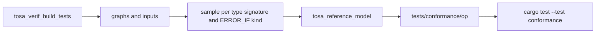

## Overview

tosa-interp is tested against the TOSA reference model from
[tosa-tools](https://pypi.org/project/tosa-tools/) (v2026.08.0). The reference
model is only needed to *create* test cases; the cases, with the reference
model's outputs, are checked in. Running the tests needs nothing but a Rust
toolchain, on any platform:

```sh
cargo test
```

Per-operator results and coverage are tracked in
[OPERATOR_STATUS.md](OPERATOR_STATUS.md).

## Test suites

| Suite | Location | What it checks |
|---|---|---|
| Unit tests | `src/**` (`#[cfg(test)]`) | Numeric building blocks: FP8 encoding, the `expf` port, broadcasting, fixed-point scaling. |
| API tests | `tests/integration.rs` | The public API: `run_graph*`, error reporting for bad inputs and invalid flatbuffers, and the hooks (`StatsCollector`, `FlopCounter`, `OpTrace`, `HookSet`), cross-checked against each other and the graph. |
| Conformance | `tests/conformance.rs` over `tests/conformance/<op>/<case>/` | Every operator against the reference model: over 3000 cases covering every type signature, special values (NaN, infinities, extreme magnitudes), attribute edge cases and every ERROR_IF kind. |
| Networks | `tests/conformance.rs` over `tests/networks/<case>/` | Multi-operator graphs against the reference model, run by the same harness and named `networks::<case>`. |

Run a single suite, or filter by name:

```sh
cargo test --lib                          # unit tests
cargo test --test integration             # API tests
cargo test --test conformance             # conformance and network cases
cargo test --test conformance conv2d      # cases whose name contains "conv2d"
cargo test --test conformance networks::  # network cases only
```

The conformance suite takes about half a minute in a debug build and a
fraction of a second with `--release`.

## The conformance harness

`tests/conformance.rs` is a custom test harness (`harness = false`, using
[libtest-mimic](https://crates.io/crates/libtest-mimic)) that turns every
directory containing a `desc.json` into one test, so the usual `cargo test`
filtering and reporting work.

### Test case format

Cases use the format of tosa-tools' `tosa_verif_build_tests`:

```json
{
 "tosa_file": "test.tosa",
 "ifm_name": ["input-0", "input-1"],
 "ifm_file": ["input-0.npy", "input-1.npy"],
 "ofm_name": ["result-0"],
 "ofm_file": ["ref-result-0.npy"],
 "expected_failure": false,
 "meta": {"compliance": {"tensors": {"result-0": {"mode": "ULP", "ulp_info": {"ulp": 5}}}}}
}
```

- `tosa_file` is the serialized graph and `ifm_file` holds one NumPy array per
  graph input.
- For positive cases, `ofm_file` holds the reference model's outputs.
- For negative (ERROR_IF) cases, `expected_failure` is `true` and there are no
  outputs; the interpreter must reject the graph with an error.
- `meta` is the generator's compliance information (optional).

### Comparison rules

The interpreter is meant to reproduce the reference model exactly, so outputs
are compared **bit for bit** (any NaN equals any NaN), with one class of
exceptions:

| Operators | Accepted difference | Why |
|---|---|---|
| ERF | 5 ULPs (the specification's bound) | The reference model calls the host C library's `erf`, `logf`, `sinf` and `cosf`. Their results differ by an ULP or two between the MSVC runtime, glibc and Apple's libm, so the expected outputs depend on where the cases were generated. tosa-interp uses the pure-Rust [`libm`](https://crates.io/crates/libm) crate instead, so its own results are identical everywhere. |
| LOG, POW, SIN, COS | 2 ULPs | As above. Observed: at most 2 ULPs against Windows-generated cases. |
| FFT2D, RFFT2D | absolute error of 2^-20 x the sum of the input magnitudes | Sums of products with `sinf`/`cosf` twiddle factors, so the error scales with the inputs. Observed: at most 3.3e-8 x the sum. |

Everything else must match exactly, including EXP, SIGMOID and TANH (the
reference bundles its own `expf`, which `src/ops/math.rs` ports exactly), the
float-accumulating operators (whose accumulation order and rounding follow
the reference) and every multi-operator network case.

Environment variables:

| Variable | Effect |
|---|---|
| `TOSA_CONFORMANCE_DIR` | Run the cases below these directories (a list separated like `PATH`) instead of `tests/conformance` and `tests/networks`. Test names are relative to each directory. |
| `TOSA_CONFORMANCE_STRICT` | Require bit-exact results for every operator. |
| `TOSA_CONFORMANCE_VERBOSE` | Print the largest deviation of every inexact output, and the error message for every rejected negative case. |

Setting a variable for one command:

```sh
TOSA_CONFORMANCE_VERBOSE=1 cargo test --test conformance   # bash, zsh
```

```powershell
$env:TOSA_CONFORMANCE_VERBOSE = "1"; cargo test --test conformance
```

## Generating test cases

The scripts in `scripts/` need Python 3.10 or later and the `tosa-tools`
wheel, which provides the test generator, the reference model executable and
its data generation library. Each script declares the wheel as inline
([PEP 723](https://peps.python.org/pep-0723/)) metadata, so with
[uv](https://docs.astral.sh/uv/) they run the same way on Windows, Linux and
macOS:

```sh
uv run scripts/gen_conformance.py --op conv2d
```

Without uv, install `tosa-tools==2026.8.0` into any environment and run the
scripts with its `python`. Set `TOSA_REF_MODEL` or `TOSA_GENERATE_LIB` to use
other reference model binaries (e.g. a source build).

### Operator suites



`scripts/gen_conformance.py --op <op>` builds an operator's suite: the
generator's cases are sampled, each sampled case runs through the reference
model, and the cases it accepts are copied, with its outputs, into
`tests/conformance/<op>/`.

- **Sampling.** The generator produces thousands of cases per operator. The
  checked-in suite keeps up to three positive cases per type signature and
  special-value variant and up to three ERROR_IF cases per error kind, drawn
  from different type signatures (`--max-positive`, `--max-negative`).
- **Full suites.** `--full` keeps every case and writes to the untracked
  `target/conformance-full`. All 90 operators' full suites, about 77,000
  cases, take roughly two hours to generate on 20 cores. Run them with
  `TOSA_CONFORMANCE_DIR=target/conformance-full cargo test --release --test conformance`.
- **Caching.** Raw generator output is cached in
  `target/conformance-gen/<op>`, so re-sampling does not rerun the generator
  (`--regenerate` forces it).
- **Determinism.** Generation is seeded (`--seed`, default 42), so
  regenerating an operator reproduces the same cases.
- **Generator workarounds.** Some operators need extra generator runs or
  custom builders (FFT2D and RFFT2D positive cases are built with the
  tosa-tools serializer); see "Known tosa-tools generator issues" in
  [OPERATOR_STATUS.md](OPERATOR_STATUS.md).

`scripts/conformance_report.py` runs the checked-in and full suites and
regenerates the summary table in [OPERATOR_STATUS.md](OPERATOR_STATUS.md),
including the coverage estimate.

### Network cases

`tests/networks/` holds multi-operator graphs:

| Case | Operators | Origin |
|---|---|---|
| `mobilenet_like` | CONV2D, DEPTHWISE_CONV2D, CLAMP, AVG_POOL2D, RESHAPE, MATMUL | Built with the tosa-tools serializer |
| `conv_matmul` | CONV2D, CLAMP, RESHAPE, MATMUL | Built with the tosa-tools serializer |
| `tf_add_f32`, `tflite_add_f32` | ADD | tosa-tools examples, legalized from TensorFlow and TFLite |
| `tf_conv2d_f32`, `tflite_conv2d_f32` | TRANSPOSE, CONV2D | tosa-tools examples, legalized from TensorFlow and TFLite |
| `tflite_conv2d_qi8` | CONV2D, RESCALE | tosa-tools example, quantized TFLite model |

The graphs and inputs are fixed; `uv run scripts/refresh_networks.py`
regenerates the expected outputs with the reference model (for example after
upgrading it). To add a case, create `tests/networks/<name>/` with the graph,
one `.npy` per input and a `desc.json` naming them, then run the script.

## Cross-platform behaviour

The suites give the same results on Windows, Linux and macOS:

- The interpreter never calls the platform C math library, so its outputs are
  identical everywhere; only the tolerances above absorb differences in the
  *reference model's* outputs.
- `.gitattributes` stores text files with LF line endings and marks `.npy`
  and `.tosa` files as binary, so checkouts are identical on every OS and
  regenerating cases on any OS produces no spurious diffs. The scripts write
  LF files on every OS.
- Paths in the harness and scripts are built with `Path` APIs and are relative
  to the repository, never to a particular machine.

## Continuous integration

`.github/workflows/ci.yml` runs on every push to `main` and every pull
request:

| Job | Runs on | Steps |
|---|---|---|
| Format and lint | Ubuntu | `cargo fmt --check`, `cargo clippy --all-targets -D warnings` |
| Test | Ubuntu, Windows, macOS | `cargo test --all-targets` (debug, so integer overflow checks are on) and `cargo test --doc` |
| Minimum supported Rust version | Ubuntu | `cargo check --all-targets` with Rust 1.88 (`rust-version` in `Cargo.toml`) |
| Generated code is up to date | Ubuntu | `cargo xtask codegen --check`, clippy on the xtask |

`.github/workflows/reference.yml` runs weekly and on demand
(`workflow_dispatch`, with an optional list of operators). On each of Ubuntu,
Windows and macOS it installs the reference model with uv and:

1. Regenerates the network outputs on that platform and fails if they differ
   from the checked-in ones.
2. Generates fresh conformance cases for a set of operators (by default the
   transcendental operators and a few integer and float ones) with that
   platform's reference model.
3. Runs the interpreter against them, checking the tolerances above against
   each platform's C library rather than only the one the checked-in cases
   were generated on. On failure the generated cases are uploaded as an
   artifact.

Dependabot keeps the GitHub Actions (pinned to commit SHAs) and Cargo
dependencies current, except `flatbuffers` and `flatc-fork`, which must be
upgraded together (see below).

## FlatBuffers bindings

`src/generated/tosa_generated.rs` is generated from `schema/tosa.fbs` by
`flatc` and checked in, so building and testing need no `flatc`. After
changing the schema:

```sh
cargo xtask codegen          # regenerate
cargo xtask codegen --check  # verify; what CI runs
```

The xtask builds `flatc` from source with the
[flatc-fork](https://crates.io/crates/flatc-fork) crate, which needs CMake and
a C++ compiler. The `flatbuffers` runtime in `Cargo.toml` must be the same
version as that `flatc`.
