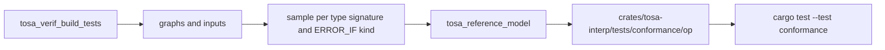

## Overview

tosa-interp is tested against the TOSA reference model from
[tosa-tools](https://pypi.org/project/tosa-tools/) (v2026.08.0). The reference
model is only needed to *create* test cases; the cases, with the reference
model's outputs, are checked in. Running the tests needs nothing but a Rust
toolchain, on any platform:

```sh
cargo test
```

Per-operator results and coverage are tracked in
[OPERATOR_STATUS.md](OPERATOR_STATUS.md).

## Test suites

| Suite | Location | What it checks |
|---|---|---|
| Unit tests | `crates/*/src/**` (`#[cfg(test)]`) | Numeric building blocks (FP8 encoding, the `expf` port, broadcasting, fixed-point scaling), the execution planner, raw tensor encoding, quantization arithmetic and layout permutations. |
| API tests | `crates/tosa-interp/tests/integration.rs` | The public API: `run_graph*`, error reporting for bad inputs and invalid flatbuffers, and the hooks (`StatsCollector`, `FlopCounter`, `OpTrace`, `HookSet`), cross-checked against each other and the graph. |
| Interpreter tests | `crates/tosa-interp/tests/interpreter.rs` | Interpreter mechanics on hand-built graphs and checked-in cases: graph validation when an `Interpreter` is created (undefined tensors, duplicate producers, cycles, oversized tensors), input and output checking, tensor lifetimes and memory accounting, persistent variables and their ordering, hooks inside COND_IF / WHILE_LOOP, and structured operator errors. |
| Conformance | `crates/tosa-interp/tests/conformance.rs` over `crates/tosa-interp/tests/conformance/<op>/<case>/` | Every operator against the reference model: over 3000 cases covering every type signature, special values (NaN, infinities, extreme magnitudes), attribute edge cases and every ERROR_IF kind. |
| Networks | `crates/tosa-interp/tests/conformance.rs` over `crates/tosa-interp/tests/networks/<case>/` | Multi-operator graphs against the reference model, run by the same harness and named `networks::<case>`. |
| IR round trips | `crates/tosa-ir/tests/roundtrip.rs` | Every checked-in `.tosa` file survives parse -> serialize -> parse unchanged, so the serializer is exercised on every operator and attribute the reference model emits. |
| Conversion framework | `crates/tosa-convert/tests/framework.rs` | A toy frontend lowered through the framework and executed by the interpreter: lowering, locations, unsupported-operator reports, output naming, the cleanup passes and RESCALE emission. |
| TFLite cases | `crates/tosa-convert/tests/tflite_cases.rs` over `tests/tflite/<case>/` | Seven small TFLite models (built by `scripts/tflite_testcases.py` from flatc JSON, outputs recorded with LiteRT's reference kernels): float, int8 and uint8 CNNs, the float element-wise and reduction operators, data-movement operators (float and uint8, including TRANSPOSE_CONV, RESIZE and STRIDED_SLICE with strides). Bit-exact for quantized outputs, within 1e-6 for float; the two cases with libm-dependent or reordered float arithmetic carry a relative tolerance of a few ulps in their `desc.json`. |
| ONNX cases | `crates/tosa-convert/tests/onnx_cases.rs` over `tests/onnx/<case>/` | Six small ONNX models (built by `scripts/onnx_testcases.py`, outputs recorded with onnxruntime): convolutions with BatchNormalization, pooling, Gemm, element-wise operators, shape arithmetic, the data-movement and normalization operators (opset 14), opset-9 Upsample, and a QLinear chain (QuantizeLinear, QLinearConv, QLinearAdd, QLinearGlobalAveragePool, QLinearMatMul, DequantizeLinear). Float results within float32 rounding of onnxruntime; the quantized case bit-exact. |
| Runtime matrix | `scripts/runtime_matrix.py` | Native runtime vs `tosa-interp` vs the TOSA reference model on every well-known model over several seeds: worst-case errors and min/median timings, written to `target/runtime-matrix/results.md`. See [CONVERSION.md](CONVERSION.md). |
| Well-known models | `crates/tosa-convert/tests/models.rs` over `target/models/<model>/` | TFLite MobileNet v1/v2 and EfficientNet-Lite0 (float and quantized) and ONNX MobileNetV2, SqueezeNet 1.1 and ResNet-18, fetched by `scripts/models.py`; skipped when absent. Same comparison rules per frontend. `cargo bench -p tosa-convert` benchmarks their conversion and execution. See [CONVERSION.md](CONVERSION.md). |

Run a single suite, or filter by name:

```sh
cargo test --lib                                        # every crate's unit tests
cargo test -p tosa-interp --test integration             # API tests
cargo test -p tosa-interp --test interpreter             # interpreter mechanics
cargo test -p tosa-interp --test conformance             # conformance and network cases
cargo test -p tosa-interp --test conformance conv2d      # cases whose name contains "conv2d"
cargo test -p tosa-interp --test conformance networks::  # network cases only
cargo test -p tosa-ir                                    # IR round trips and the builder
cargo test -p tosa-convert                               # the conversion framework
```

The conformance suite takes well under a second in either build mode (the
cases are small); `cargo bench` runs the network cases under
[criterion](https://crates.io/crates/criterion) in release mode to track
interpreter throughput.

## The conformance harness

`crates/tosa-interp/tests/conformance.rs` is a custom test harness (`harness = false`, using
[libtest-mimic](https://crates.io/crates/libtest-mimic)) that turns every
directory containing a `desc.json` into one test, so the usual `cargo test`
filtering and reporting work.

### Test case format

Cases use the format of tosa-tools' `tosa_verif_build_tests`:

```json
{
 "tosa_file": "test.tosa",
 "ifm_name": ["input-0", "input-1"],
 "ifm_file": ["input-0.npy", "input-1.npy"],
 "ofm_name": ["result-0"],
 "ofm_file": ["ref-result-0.npy"],
 "expected_failure": false,
 "meta": {"compliance": {"tensors": {"result-0": {"mode": "ULP", "ulp_info": {"ulp": 5}}}}}
}
```

- `tosa_file` is the serialized graph and `ifm_file` holds one NumPy array per
  graph input.
- For positive cases, `ofm_file` holds the reference model's outputs.
- For negative (ERROR_IF) cases, `expected_failure` is `true` and there are no
  outputs; the interpreter must reject the graph with an error.
- `meta` is the generator's compliance information (optional).

### Comparison rules

The interpreter is meant to reproduce the reference model exactly, so outputs
are compared **bit for bit** (any NaN equals any NaN), with one class of
exceptions:

| Operators | Accepted difference | Why |
|---|---|---|
| ERF | 5 ULPs (the specification's bound) | The reference model calls the host C library's `erf`, `logf`, `sinf` and `cosf`. Their results differ by an ULP or two between the MSVC runtime, glibc and Apple's libm, so the expected outputs depend on where the cases were generated. tosa-interp uses the pure-Rust [`libm`](https://crates.io/crates/libm) crate instead, so its own results are identical everywhere. |
| LOG, POW, SIN, COS | 2 ULPs | As above. Observed: at most 2 ULPs against Windows-generated cases. |
| FFT2D, RFFT2D | absolute error of 2^-20 x the sum of the input magnitudes | Sums of products with `sinf`/`cosf` twiddle factors, so the error scales with the inputs. Observed: at most 3.3e-8 x the sum. |

Everything else must match exactly, including EXP, SIGMOID and TANH (the
reference bundles its own `expf`, which `crates/tosa-interp/src/ops/math.rs` ports exactly), the
float-accumulating operators (whose accumulation order and rounding follow
the reference) and every multi-operator network case.

Environment variables:

| Variable | Effect |
|---|---|
| `TOSA_CONFORMANCE_DIR` | Run the cases below these directories (a list separated like `PATH`) instead of the checked-in `conformance` and `networks` directories. Test names are relative to each directory. |
| `TOSA_CONFORMANCE_STRICT` | Require bit-exact results for every operator. |
| `TOSA_CONFORMANCE_VERBOSE` | Print the largest deviation of every inexact output, and the error message for every rejected negative case. |

Setting a variable for one command:

```sh
TOSA_CONFORMANCE_VERBOSE=1 cargo test -p tosa-interp --test conformance   # bash, zsh
```

```powershell
$env:TOSA_CONFORMANCE_VERBOSE = "1"; cargo test -p tosa-interp --test conformance
```

## Generating test cases

The scripts in `scripts/` need Python 3.10 or later and the `tosa-tools`
wheel, which provides the test generator, the reference model executable and
its data generation library. Each script declares the wheel as inline
([PEP 723](https://peps.python.org/pep-0723/)) metadata, so with
[uv](https://docs.astral.sh/uv/) they run the same way on Windows, Linux and
macOS:

```sh
uv run scripts/gen_conformance.py --op conv2d
```

Without uv, install `tosa-tools==2026.8.0` into any environment and run the
scripts with its `python`. Set `TOSA_REF_MODEL` or `TOSA_GENERATE_LIB` to use
other reference model binaries (e.g. a source build).

### Operator suites



`scripts/gen_conformance.py --op <op>` builds an operator's suite: the
generator's cases are sampled, each sampled case runs through the reference
model, and the cases it accepts are copied, with its outputs, into
`crates/tosa-interp/tests/conformance/<op>/`.

- **Sampling.** The generator produces thousands of cases per operator. The
  checked-in suite keeps up to three positive cases per type signature and
  special-value variant and up to three ERROR_IF cases per error kind, drawn
  from different type signatures (`--max-positive`, `--max-negative`).
- **Full suites.** `--full` keeps every case and writes to the untracked
  `target/conformance-full`. All 90 operators' full suites, about 77,000
  cases, take roughly two hours to generate on 20 cores. Run them with
  `TOSA_CONFORMANCE_DIR=target/conformance-full cargo test --release -p tosa-interp --test conformance`.
- **Caching.** Raw generator output is cached in
  `target/conformance-gen/<op>`, so re-sampling does not rerun the generator
  (`--regenerate` forces it).
- **Determinism.** Generation is seeded (`--seed`, default 42), so
  regenerating an operator reproduces the same cases.
- **Generator workarounds.** Some operators need extra generator runs or
  custom builders (FFT2D and RFFT2D positive cases are built with the
  tosa-tools serializer); see "Known tosa-tools generator issues" in
  [OPERATOR_STATUS.md](OPERATOR_STATUS.md).

`scripts/conformance_report.py` runs the checked-in and full suites and
regenerates the summary table in [OPERATOR_STATUS.md](OPERATOR_STATUS.md),
including the coverage estimate.

### Network cases

`crates/tosa-interp/tests/networks/` holds multi-operator graphs:

| Case | Operators | Origin |
|---|---|---|
| `mobilenet_like` | CONV2D, DEPTHWISE_CONV2D, CLAMP, AVG_POOL2D, RESHAPE, MATMUL | Built with the tosa-tools serializer |
| `conv_matmul` | CONV2D, CLAMP, RESHAPE, MATMUL | Built with the tosa-tools serializer |
| `tf_add_f32`, `tflite_add_f32` | ADD | tosa-tools examples, legalized from TensorFlow and TFLite |
| `tf_conv2d_f32`, `tflite_conv2d_f32` | TRANSPOSE, CONV2D | tosa-tools examples, legalized from TensorFlow and TFLite |
| `tflite_conv2d_qi8` | CONV2D, RESCALE | tosa-tools example, quantized TFLite model |

The graphs and inputs are fixed; `uv run scripts/refresh_networks.py`
regenerates the expected outputs with the reference model (for example after
upgrading it). To add a case, create `crates/tosa-interp/tests/networks/<name>/` with the graph,
one `.npy` per input and a `desc.json` naming them, then run the script.

## Cross-platform behaviour

The suites give the same results on Windows, Linux and macOS:

- The interpreter never calls the platform C math library, so its outputs are
  identical everywhere; only the tolerances above absorb differences in the
  *reference model's* outputs.
- `.gitattributes` stores text files with LF line endings and marks `.npy`
  and `.tosa` files as binary, so checkouts are identical on every OS and
  regenerating cases on any OS produces no spurious diffs. The scripts write
  LF files on every OS.
- Paths in the harness and scripts are built with `Path` APIs and are relative
  to the repository, never to a particular machine.

## Continuous integration

`.github/workflows/ci.yml` runs on every push to `main` and every pull
request:

| Job | Runs on | Steps |
|---|---|---|
| Format and lint | Ubuntu | `cargo fmt --check`, `cargo clippy --all-targets -D warnings` |
| Test | Ubuntu, Windows, macOS | `cargo test --all-targets` across the workspace (debug, so integer overflow checks are on) and `cargo test --doc` |
| Minimum supported Rust version | Ubuntu | `cargo check --all-targets` with Rust 1.88 (`rust-version` in `Cargo.toml`) |
| Generated code is up to date | Ubuntu | Installs the prebuilt `flatc` release matching the `flatbuffers` crate (checksum verified), then `cargo xtask codegen --check` and clippy on the xtask |
| Well-known models | Ubuntu | `uv run scripts/models.py` (downloads cached by hash), `cargo test --release -p tosa-convert --test models`, builds the model benchmarks |

`.github/workflows/reference.yml` runs weekly and on demand
(`workflow_dispatch`, with an optional list of operators). On each of Ubuntu,
Windows and macOS it installs the reference model with uv and:

1. Regenerates the network outputs on that platform and fails if they differ
   from the checked-in ones.
2. Generates fresh conformance cases for a set of operators (by default the
   transcendental operators and a few integer and float ones) with that
   platform's reference model.
3. Runs the interpreter against them, checking the tolerances above against
   each platform's C library rather than only the one the checked-in cases
   were generated on. On failure the generated cases are uploaded as an
   artifact.
4. On Linux and macOS, converts the well-known TFLite and ONNX models with
   the `tosa` CLI and runs the converted graphs through the reference model
   (`scripts/models.py --verify`), so the emitted TOSA is checked by the
   specification's own implementation.
5. On Linux, runs the cross-runtime matrix (`scripts/runtime_matrix.py`)
   and uploads `results.md` and `results.json` as an artifact.

Dependabot keeps the GitHub Actions (pinned to commit SHAs) and Cargo
dependencies current, except `flatbuffers` and `flatc-fork`, which must be
upgraded together (see below).

## FlatBuffers bindings

`crates/tosa-ir/src/generated/tosa_generated.rs` is generated from `crates/tosa-ir/schema/tosa.fbs` by
`flatc` and checked in, so building and testing need no `flatc`. After
changing the schema:

```sh
cargo xtask codegen          # regenerate
cargo xtask codegen --check  # verify; what CI runs
```

The xtask runs an installed `flatc` (`$FLATC` or `flatc` on `PATH`) and
refuses versions other than the `flatbuffers` runtime's (25.12.19); use the
package manager or the prebuilt release archive, as CI does. It regenerates
the TOSA bindings and the TFLite bindings in `crates/tosa-convert`.
